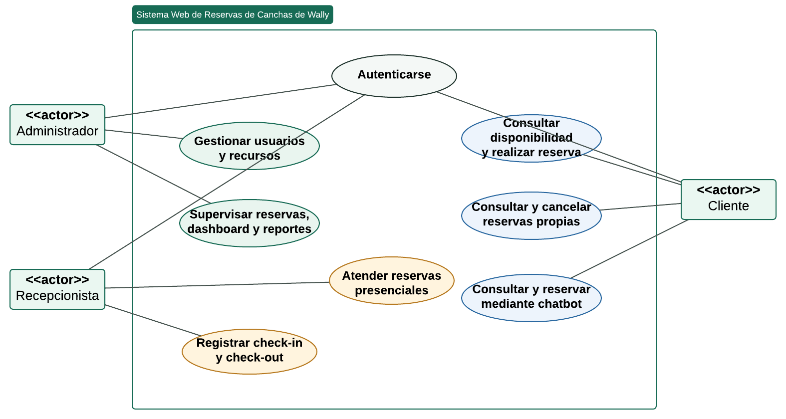
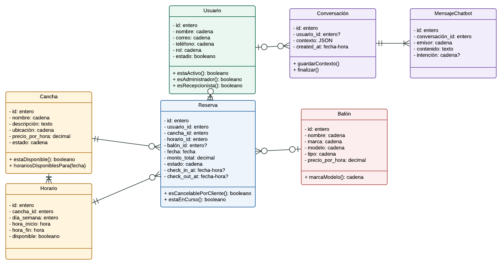
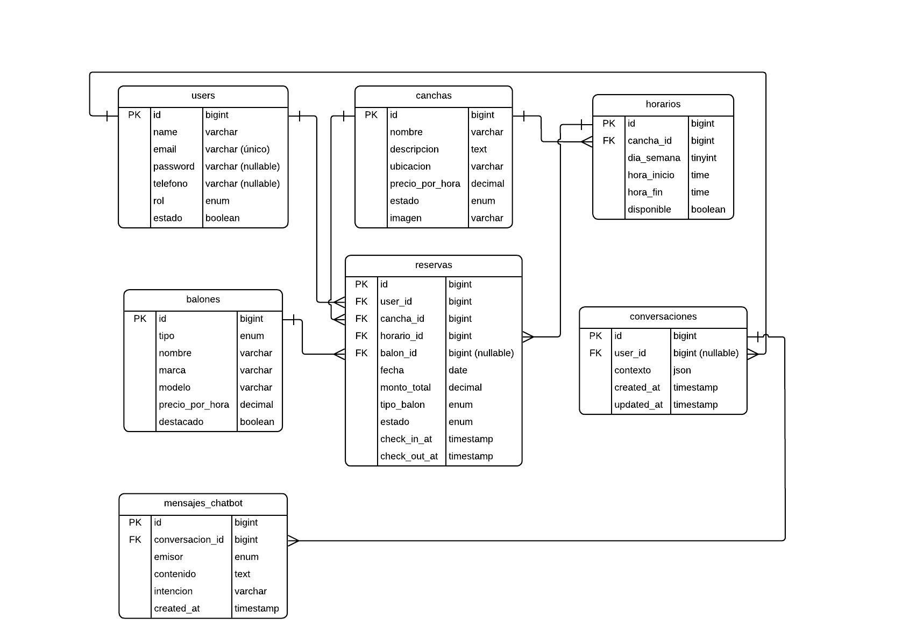
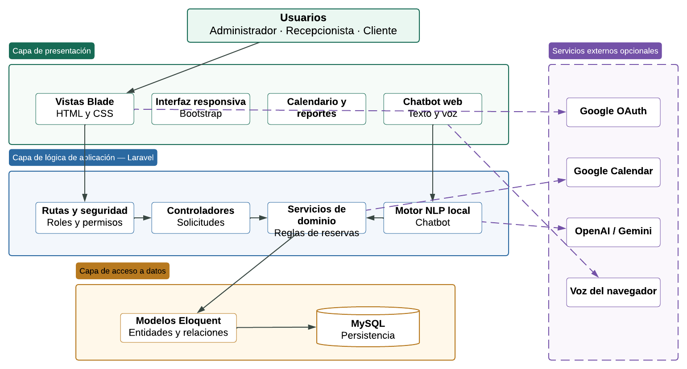

# CAPÍTULO III: INGENIERÍA DEL PROYECTO

El presente capítulo describe el proceso de ingeniería aplicado al desarrollo del sistema web de reservas para canchas de Wally. Para organizar el trabajo se adopta la metodología ágil Scrum, la cual permite dividir el proyecto en periodos cortos de desarrollo denominados sprints. En cada sprint se desarrolla y verifica un conjunto de funcionalidades, facilitando la mejora progresiva del sistema y la revisión de los resultados obtenidos.

Antes de describir los sprints se presentan los requerimientos generales, los actores, los modelos UML, el diseño de la base de datos y la arquitectura del sistema. Estos elementos constituyen la base para comprender su funcionamiento y la forma en que sus componentes se relacionan.

## 3.1 Requerimientos Generales del Sistema

Los requerimientos generales establecen las funciones principales y las condiciones de calidad que debe cumplir el sistema. Su definición se realizó considerando los objetivos establecidos en el Capítulo I y las necesidades propias del proceso de reserva y atención en un complejo deportivo de Wally.

### 3.1.1 Requerimientos Funcionales Generales

- **Autenticación y control de acceso.** El sistema permitirá el registro e inicio de sesión de los usuarios y asignará diferentes opciones de acuerdo con el rol de Administrador, Recepcionista o Cliente.

- **Gestión de usuarios y recursos.** El Administrador podrá gestionar las cuentas de usuario, las canchas, los horarios disponibles y los balones ofrecidos por el complejo deportivo.

- **Gestión de reservas.** El Cliente podrá consultar la disponibilidad de las canchas, seleccionar una fecha y horario, realizar una reserva y revisar o cancelar sus reservas cuando corresponda.

- **Atención en recepción.** El Recepcionista podrá consultar la agenda de reservas, registrar reservas presenciales y controlar el ingreso y la salida de los clientes.

- **Control administrativo.** El Administrador podrá supervisar las reservas, modificar su estado, consultar el calendario general y visualizar información resumida sobre el funcionamiento del sistema.

- **Reportes.** El sistema permitirá generar reportes de reservas aplicando filtros y exportar la información para facilitar su revisión administrativa.

- **Atención mediante chatbot.** El sistema incorporará un chatbot basado en procesamiento de lenguaje natural, capaz de responder consultas sobre canchas, precios, horarios y disponibilidad, además de orientar al Cliente durante la creación de una reserva.

Las funciones de autenticación con Google, sincronización con Google Calendar, reconocimiento de voz y proveedor generativo se consideran complementarias. El proceso principal de reservas podrá funcionar sin depender de estos servicios externos.

### 3.1.2 Requerimientos No Funcionales Generales

- **Usabilidad.** La interfaz deberá ser clara, responsiva y comprensible para usuarios con conocimientos básicos de informática, utilizando mensajes y opciones en idioma español.

- **Seguridad.** El sistema protegerá la información mediante contraseñas cifradas, validación de datos, control de sesiones y permisos diferenciados según el rol del usuario.

- **Rendimiento.** Las consultas de disponibilidad, reservas y atención mediante chatbot deberán responder en un tiempo adecuado bajo condiciones normales de funcionamiento.

- **Disponibilidad y compatibilidad.** El sistema podrá utilizarse desde navegadores web modernos y conservará sus funciones principales aunque las integraciones externas no se encuentren configuradas.

- **Mantenibilidad.** La aplicación empleará una estructura modular basada en el patrón Modelo–Vista–Controlador, permitiendo realizar correcciones o incorporar mejoras sin afectar todo el sistema.

### 3.1.3 Identificación y Descripción de los Actores del Sistema

Para el sistema web de reservas de canchas de Wally se identifican tres actores principales. Cada actor representa un tipo de usuario y posee funciones definidas de acuerdo con sus responsabilidades dentro del proceso de reserva y atención.

| Actores | Tareas principales | Alcance |
|---|---|---|
| Administrador | Gestionar usuarios, canchas, horarios y balones; supervisar reservas; consultar reportes y configurar el sistema. | Acceso a los módulos administrativos y a la información general del sistema. |
| Recepcionista | Consultar la agenda, buscar clientes, registrar reservas presenciales y controlar el ingreso y salida. | Acceso a las funciones operativas de atención, sin modificar la configuración general. |
| Cliente | Consultar canchas y disponibilidad, realizar reservas, revisar sus reservas y utilizar el chatbot. | Acceso a la información pública y a sus propios datos y reservas. |

El Visitante participa únicamente en las consultas públicas y en el registro de una cuenta. Los servicios de Google y el proveedor generativo son actores externos opcionales y se incluirán en los modelos solamente cuando intervengan de forma directa.

Estos actores permiten delimitar las acciones representadas en el diagrama general de casos de uso. No se incluyen el rol Gerente, pagos, arquitectura multiagente ni auditoría formal, debido a que no forman parte del alcance actual del sistema.

### 3.1.4 Diagrama de Casos de Uso General

El diagrama general de casos de uso representará la interacción de los tres actores principales con el sistema. El Administrador se relacionará con la configuración y supervisión; el Recepcionista con la atención operativa; y el Cliente con la consulta y gestión de sus reservas.

Para conservar su legibilidad, el diagrama agrupará las operaciones relacionadas y no mostrará una figura independiente para cada acción de creación, edición o eliminación. El Visitante y los servicios externos solo aparecerán cuando su participación sea necesaria.

### 3.1.5 Diagrama de Clases General

El diagrama de clases mostrará las principales entidades del dominio y sus relaciones. Entre ellas se encuentran Usuario, Cancha, Horario, Reserva, Balón, Conversación y Mensaje. También se representarán las asociaciones necesarias para comprender qué Cliente realiza una reserva, qué cancha y horario selecciona y cómo se conserva una conversación con el chatbot.

El modelo se mantendrá a un nivel general, incluyendo los atributos y métodos más relevantes, sin reproducir todos los elementos internos del framework. De este modo, el diagrama explicará la estructura del negocio y no una copia completa del código fuente.

### 3.1.6 Diseño de Base de Datos General

La base de datos del sistema se encuentra diseñada bajo el modelo relacional y utiliza MySQL como sistema gestor. Su función es almacenar de manera organizada la información de usuarios, canchas, horarios, reservas, balones, conversaciones e integraciones complementarias.

Las tablas se relacionan mediante claves primarias y foráneas, lo cual permite mantener la correspondencia entre los registros. Por ejemplo, una reserva se vincula con el Cliente que la realizó, la cancha seleccionada y el horario correspondiente.

#### 3.1.6.1 Modelo Relacional

El modelo relacional organiza la información en entidades conectadas entre sí. Esta estructura facilita la consulta de disponibilidad, el seguimiento de reservas y la generación de reportes, manteniendo la consistencia de los datos utilizados por los diferentes módulos.

#### 3.1.6.2 Nivel de Normalización

En el diseño se aplican criterios de normalización hasta la Tercera Forma Normal. Los atributos almacenan valores definidos, dependen de la clave de su entidad y la información repetitiva se separa en tablas relacionadas. Con ello se reducen duplicaciones y problemas durante la inserción o actualización de datos.

#### 3.1.6.3 Estructura General de la Base de Datos

La estructura está compuesta por tablas propias de Laravel para autenticación, sesiones y trabajos internos; y por tablas creadas para las funciones del proyecto, como canchas, horarios, reservas, balones, conversaciones, mensajes y configuraciones. Las integraciones con Google utilizan tablas complementarias para conservar las vinculaciones y los eventos sincronizados.

### 3.1.7 Arquitectura del Sistema

El sistema fue desarrollado mediante una arquitectura web basada en el patrón Modelo–Vista–Controlador de Laravel. Esta organización separa la presentación, el procesamiento de las solicitudes y el acceso a los datos, facilitando el mantenimiento de la aplicación.

#### 3.1.7.1 Capa de Presentación

Comprende las páginas utilizadas por el Administrador, Recepcionista y Cliente. Se implementa mediante plantillas Blade, HTML, CSS, JavaScript y Bootstrap, permitiendo presentar formularios, tablas, calendarios y componentes adaptables a diferentes tamaños de pantalla.

#### 3.1.7.2 Capa de Lógica del Sistema

Está formada por los controladores, servicios y reglas de validación de Laravel. Esta capa recibe las acciones del usuario, comprueba sus permisos y aplica las reglas necesarias antes de consultar o modificar la información.

#### 3.1.7.3 Capa de Acceso a Datos

Utiliza los modelos de Eloquent para relacionar la lógica del sistema con MySQL. Los modelos representan las principales entidades y permiten realizar consultas manteniendo las relaciones y restricciones definidas en la base de datos.

#### 3.1.7.4 Servicios Externos

La arquitectura admite servicios complementarios para autenticación con Google, sincronización con Google Calendar, respuestas generativas y reconocimiento de voz. Estas integraciones son opcionales y se comunican con el sistema mediante componentes controlados, sin modificar directamente la información de las reservas.

#### 3.1.7.5 Comunicación entre Capas

El usuario realiza una solicitud desde el navegador; el controlador la recibe y aplica las validaciones; los servicios procesan las reglas del negocio; y los modelos consultan o actualizan la base de datos. Finalmente, el resultado vuelve a la interfaz en forma de página, mensaje o respuesta del chatbot.

El diagrama de arquitectura resume esta comunicación y distingue los componentes internos de las integraciones externas. Los diagramas de actividad y secuencia se reservarán para los procesos principales descritos posteriormente en los sprints, evitando repetir información.

**Fuente:** elaboración propia con base en el análisis del sistema Wally Reservas.
